

# Gestão Platform

### O sistema de gestão que fala a língua do pequeno negócio.

ERP **multiempresa**, **modular** e **mobile-first** para lanchonetes, lojas, depósitos de material
de construção, prestadores de serviço e comércio em geral. Um único núcleo, com vocabulário,
menu e cores de cada segmento.

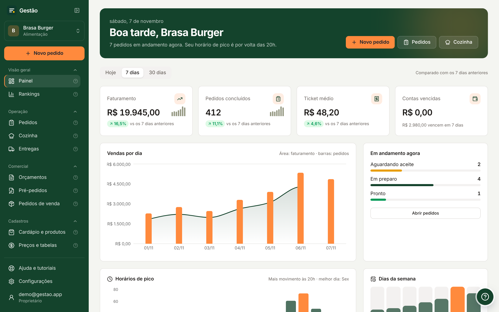

> **Repositório vitrine.** Aqui estão a apresentação, a documentação e as imagens do produto.
> O código-fonte é privado. Quer ver funcionando ou conversar sobre o projeto?
> Fale comigo pelo [LinkedIn](https://www.linkedin.com/in/allandemelocorrea-45875016a) ou abra uma
> [issue](https://github.com/allancorreaz/gestao-plataform-public/issues).

---

## Sumário

- [Por que existe](#por-que-existe)
- [Destaques](#destaques)
- [Telas](#telas)
- [Tudo o que o sistema faz](#tudo-o-que-o-sistema-faz)
- [Segmentos](#segmentos)
- [Arquitetura](#arquitetura)
- [Stack](#stack)
- [Segurança](#segurança)
- [Qualidade e testes](#qualidade-e-testes)
- [Infraestrutura a custo zero](#infraestrutura-a-custo-zero)
- [Ilustrações 3D](#ilustrações-3d)
- [Planos](#planos)
- [Roteiro](#roteiro)
- [Documentação](#documentação)
- [Autor](#autor)

---

## Por que existe

Pequenos negócios costumam escolher entre **planilha + caderno** ou um **ERP caro e complicado**,
feito para indústria. O Gestão Platform é o meio do caminho: entra funcionando no primeiro dia,
com dados de exemplo do próprio segmento, e cresce junto, liberando módulos quando o negócio
precisa.

**Uma venda registrada uma vez atualiza tudo:** estoque (pela ficha técnica), financeiro (com a
taxa e o prazo da maquininha), painel, DRE e auditoria.

## Destaques

|     | Recurso                         | Em uma frase                                                                                    |
| --- | ------------------------------- | ----------------------------------------------------------------------------------------------- |
| 🍔  | **Cardápio digital com QR**     | O cliente pede pelo celular, sem baixar app, e o pedido cai na cozinha em tempo real.            |
| 💰  | **Formação de preço**           | Custo + frete + impostos → markup ou margem desejada → preço sugerido e reprecificação em massa. |
| 📄  | **Orçamento → pedido → nota**   | Fluxo comercial completo com PDF, WhatsApp, limite de desconto e reserva de estoque.             |
| 📦  | **Estoque com WMS**             | Depósitos, endereços, transferências entre empresas, inventário e rastreio de cada movimento.    |
| 🧾  | **Fiscal pronto**               | NF-e, NFC-e e NFS-e validadas antes do envio, com numeração sem buracos.                         |
| 💳  | **12x por bandeira**            | Taxa, juros por parcela e prazo de recebimento configurados por bandeira de cartão.              |
| 📊  | **Painel + DRE**                | Comparação com o período anterior, horários de pico, canais e ponto de equilíbrio.               |
| 🎨  | **A marca do cliente**          | Cada empresa escolhe suas cores; o sistema inteiro e o cardápio se adaptam.                      |
| 🧭  | **Tour guiado**                 | Cada tela ensina a si mesma com destaque passo a passo.                                          |

## Telas

| Painel                                         | Produtos com ilustrações 3D                        |
| ---------------------------------------------- | -------------------------------------------------- |
|  | 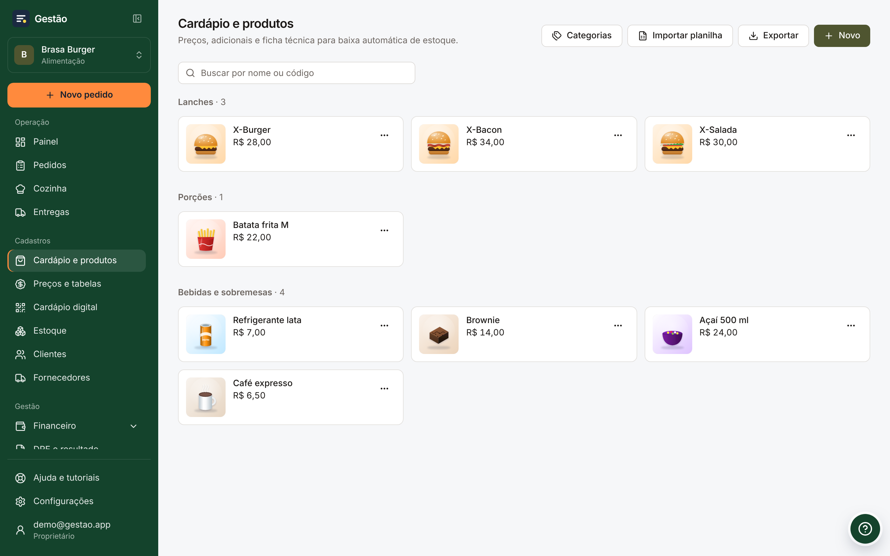 |
| **Formação de preço**                          | **Orçamento (material de construção)**             |
| 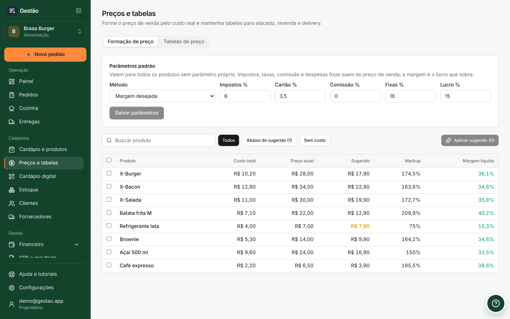 | 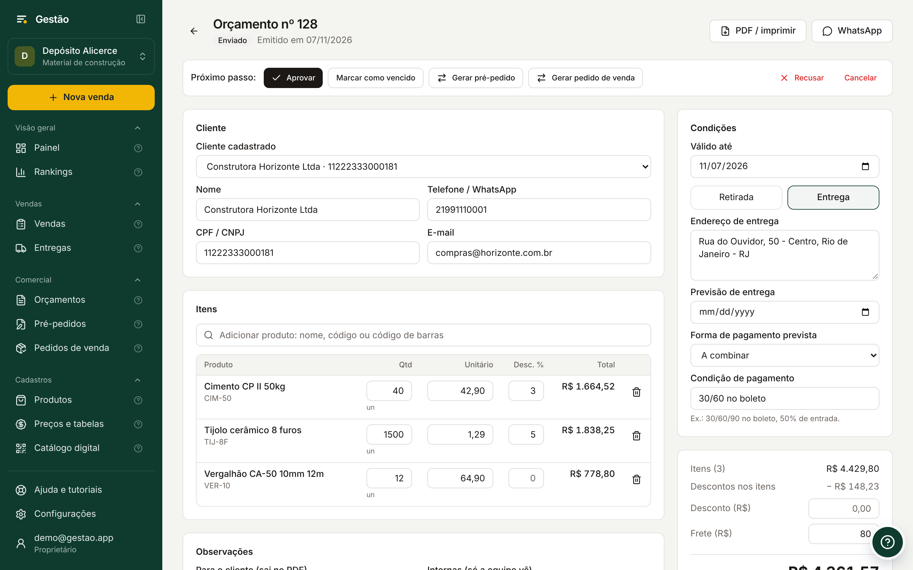 |

<table>
<tr>
<td width="300">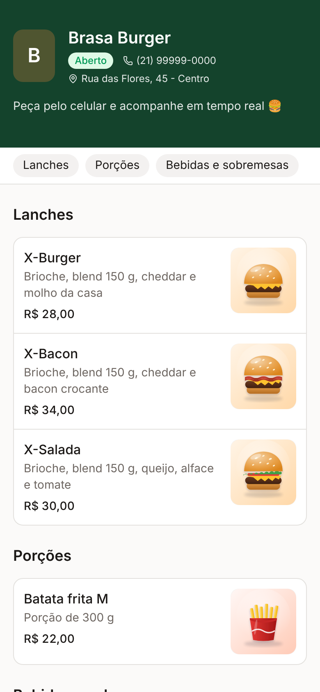</td>
<td>

### Cardápio digital

- Link e **QR Code por mesa**
- Pedido **sem cadastro**
- Horário de funcionamento automático
- **Pix copia e cola** com QR Code
- "Meus pedidos" e "Pedir de novo"
- Nas **cores da marca** do estabelecimento
- Limite antiabuso por telefone

</td>
</tr>
</table>

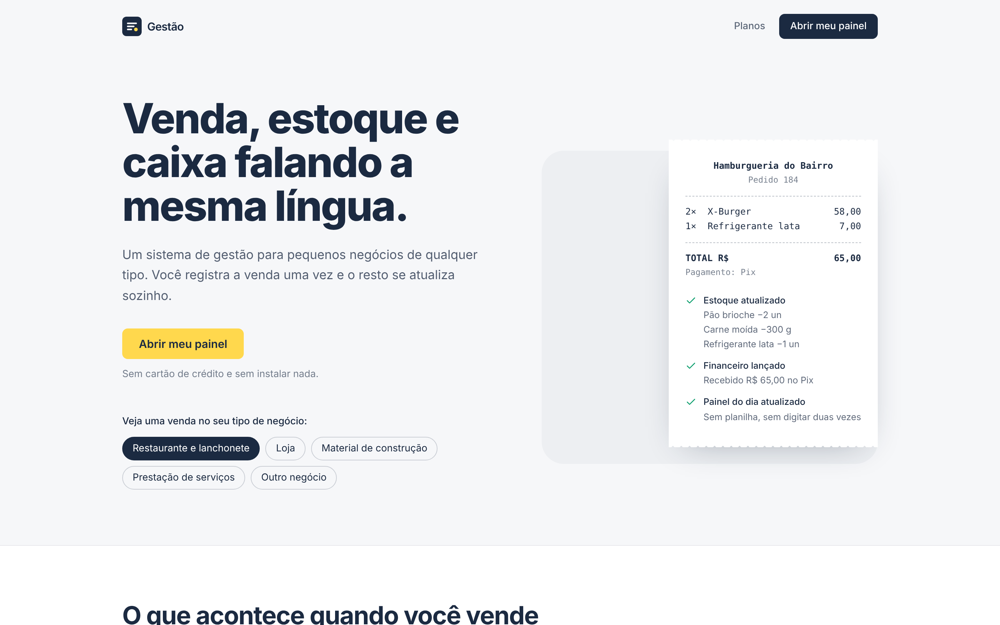

> Todas as capturas usam **dados fictícios**, geradas automaticamente com Playwright e um banco
> simulado.

## Tudo o que o sistema faz

| Área                 | Recursos                                                                                                                                                                         |
| -------------------- | -------------------------------------------------------------------------------------------------------------------------------------------------------------------------------- |
| **Vendas**           | PDV com busca, adicionais e tabela de preço · pedidos em tempo real · cozinha (KDS) · devolução e troca com crédito · impressão 80 mm · WhatsApp com mensagem pronta              |
| **Cardápio digital** | QR por mesa · pedido sem conta · horário de funcionamento · Pix com QR · "Pedir de novo" · cores da marca                                                                       |
| **Comercial**        | Orçamento → pré-pedido → pedido de venda → faturamento · negociação de preço só pela gestão · limite de desconto por papel · PDF A4 · reserva de estoque                          |
| **Entregas**         | Ordem de entrega a partir da venda · romaneio com assinatura · etapas (carregando, em rota, entregue) · valor a cobrar · link do mapa                                            |
| **Preços**           | Composição de custo (compra, frete, IPI/ST, outros) · markup ou margem (markup divisor) · reprecificação em massa · tabelas com ajuste %, preço próprio, faixas e validade         |
| **Pagamentos**       | Formas com taxa e prazo · cartão por bandeira · até 12x com "sem juros até" e juros por parcela · crédito do cliente                                                             |
| **Estoque e WMS**    | Ficha técnica · custo médio · saldo, reservado e previsto · compras · depósitos e endereços · transferências entre depósitos, filiais e empresas · inventário · movimentações     |
| **Planilhas**        | Modelo .xlsx com instruções · importação de produtos, preços, custos, estoque e fiscal · exportação · erro por linha sem travar o resto                                           |
| **Financeiro**       | A pagar e a receber com valor líquido · baixas · fluxo de caixa · **DRE** com análise vertical, comparação e ponto de equilíbrio                                                 |
| **Fiscal**           | Emitente com consulta de CNPJ · NCM, CEST, CFOP, CST/CSOSN · NF-e, NFC-e e NFS-e validadas contra rejeições comuns · fila e cancelamento · integração com provedor (Focus NFe)  |
| **Cadastros**        | Clientes PF/PJ com IE e regime tributário · **CEP e CNPJ preenchem sozinhos** · fornecedores · equipe por convite com papéis                                                     |
| **Gestão**           | Auditoria de tudo com antes/depois · licenciamento por plano e módulo · superadmin com receita recorrente                                                                        |
| **Experiência**      | Tour guiado · central de ajuda · cores da marca · PWA instalável · dados de exemplo por segmento                                                                                |

## Segmentos

O mesmo banco e as mesmas telas, com a linguagem de cada negócio:

| Segmento                   | Chama a venda de | Ênfase                                                     |
| -------------------------- | ---------------- | ---------------------------------------------------------- |
| 🍔 Lanchonete / restaurante | Pedido           | Cardápio digital, cozinha, adicionais, ficha técnica       |
| 👕 Loja / varejo            | Venda            | PDV, grade de produtos, crediário, tabelas de preço        |
| 🧱 Material de construção   | Pedido           | Orçamento, entrega com romaneio, venda por quantidade, WMS |
| 🛠️ Prestador de serviço     | Atendimento      | Orçamento, NFS-e, agenda de atendimento                    |
| 🏪 Comércio em geral        | Venda            | O essencial de tudo                                        |

## Arquitetura

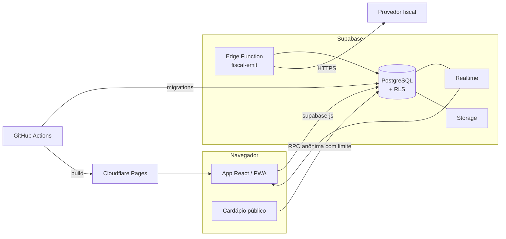

**Decisões que fazem a diferença:**

- **Regra de negócio no banco.** Preço, estoque, financeiro, status, numeração fiscal e limites
  de desconto vivem em funções PostgreSQL `SECURITY DEFINER`. O navegador nunca define um preço
  nem um saldo: mesmo que alguém altere o front, o banco recusa.
- **Tudo vira movimentação.** O estoque só muda por movimentos (com depósito e endereço) e o
  dinheiro só por lançamentos. Nada é sobrescrito: há histórico completo e auditável.
- **Modelo híbrido de segmentos.** Um arquivo de configuração define vocabulário, menu e cor por
  segmento; banco e rotas são compartilhados. Novo segmento = configuração, não reescrita.
- **Idempotência.** Pedidos aceitam chave de idempotência: clique duplo não duplica venda.
- **Módulos por empresa.** Cada módulo é ligado pelo plano e conferido no banco, não só no menu.

Mais detalhes em [docs/ARQUITETURA.md](docs/ARQUITETURA.md).

## Stack

| Camada             | Tecnologia                                                                  |
| ------------------ | --------------------------------------------------------------------------- |
| Interface          | **React 19** · **TypeScript strict** · Vite 8 · React Router 7               |
| Estilo             | **Tailwind CSS v4** · componentes no padrão shadcn/ui (Radix) · lucide-react |
| Estado de servidor | **TanStack Query**                                                          |
| Formulários        | React Hook Form + **Zod**                                                   |
| Gráficos           | Recharts                                                                    |
| Tour guiado        | driver.js                                                                   |
| Planilhas          | read-excel-file · write-excel-file                                          |
| Banco              | **PostgreSQL** (Supabase) com Row Level Security e PL/pgSQL                 |
| Auth / Realtime    | Supabase Auth · Supabase Realtime                                           |
| Funções            | Supabase Edge Functions (Deno)                                              |
| Hospedagem         | Cloudflare Pages (CDN global)                                               |
| CI/CD              | GitHub Actions: lint, tipos, testes, build, migrations, backup              |
| Testes             | Vitest · **PGlite** (Postgres em memória) · Playwright (capturas)           |
| APIs públicas      | ViaCEP · BrasilAPI (CNPJ)                                                   |

## Segurança

- **Isolamento total entre empresas** por Row Level Security em todas as tabelas.
- **Seis papéis** (proprietário, administrador, gerente, caixa, cozinha, atendente); cada função
  do banco confere o papel antes de agir.
- **Colunas protegidas:** plano, status, cores da marca e numeração fiscal não aceitam alteração
  direta.
- **Credencial fiscal só de escrita:** o token do provedor é gravado, mas ninguém o lê de volta.
- **Cardápio público** limitado a funções específicas, com antiabuso.
- **Auditoria** de inserções, alterações e exclusões com antes, depois e autor.
- **Licença operacional:** fora do período pago (+ tolerância), o sistema fica somente leitura.

## Qualidade e testes

**66 testes automatizados** rodam em segundos, sem servidor, inclusive os do banco: as migrations
são aplicadas num **PostgreSQL em memória (PGlite)** e as regras são testadas de verdade.

- Isolamento entre empresas e permissões por papel
- Preço calculado pelo servidor e idempotência
- Estoque e financeiro na conclusão da venda, devoluções, compras
- Tabelas de preço, parcelamento por bandeira, importação de planilha
- Transferência entre empresas, inventário, orçamento → venda, entregas
- Validações fiscais e numeração
- Dados de exemplo dos 5 segmentos
- Cálculo do DRE, formação de preço, CPF/CNPJ

Toda alteração passa por **lint + formatação + tipos + testes + build** no CI, e as migrations
são aplicadas automaticamente ao entrar na `main`.

## Infraestrutura a custo zero

| Serviço          | Plano | Uso                                               |
| ---------------- | ----- | ------------------------------------------------- |
| Supabase         | Free  | Banco, autenticação, realtime, storage            |
| Cloudflare Pages | Free  | Frontend com CDN e preview por branch             |
| GitHub Actions   | Free  | CI, migrations, backup semanal, keep-alive diário |

## Ilustrações 3D

Os dados de exemplo de cada segmento vêm com **ilustrações 3D geradas por código** (SVG com
gradientes, luz e sombra), leves e sem direitos de terceiros:

|   |   |   |   |   |   |
|:-:|:-:|:-:|:-:|:-:|:-:|
|  acai |  areia |  argamassa | 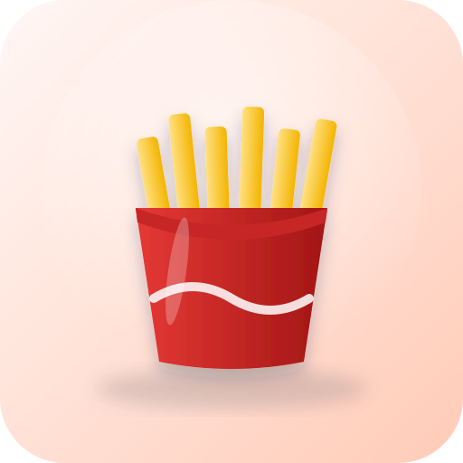 batata frita |  bone |  brita |
| 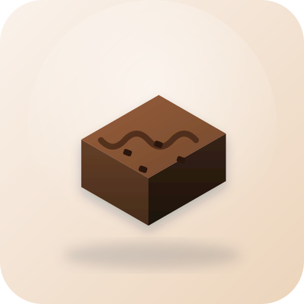 brownie |  caderno |  cafe |  calca jeans |  camiseta azul |  camiseta preta |
|  caneta | 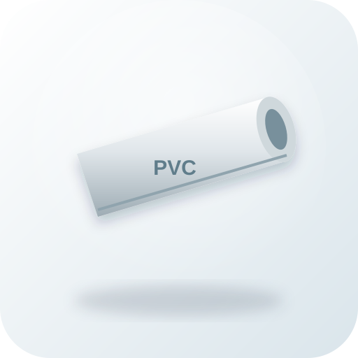 cano pvc |  chave | 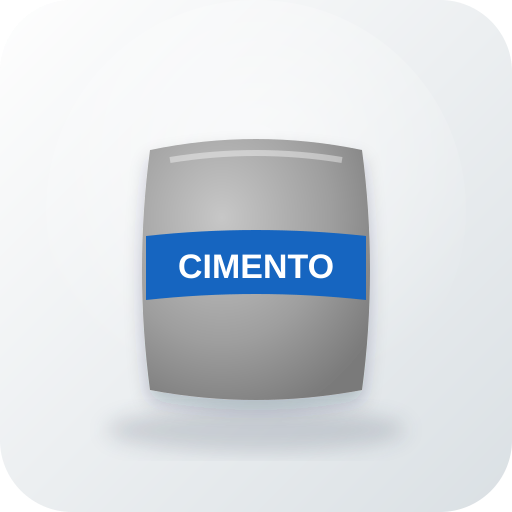 cimento |  fone |  furadeira |
|  garrafa |  lampada |  meia |  mochila |  prancheta |  refrigerante |
|  rolo pintura |  telha |  tesoura | 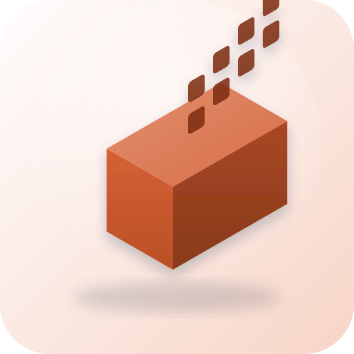 tijolo | 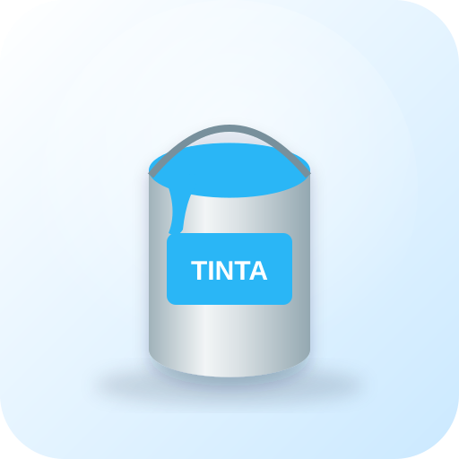 tinta | 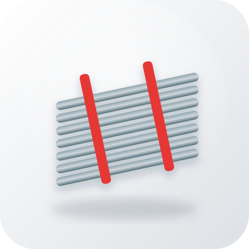 vergalhao |
|  x bacon |  x burger |  x salada |  |  |  |

## Planos

Módulos são liberados por plano e podem ser ajustados por empresa. **Na avaliação, tudo fica
liberado.**

| Módulo                                                                  | Inicial | Profissional | Empresarial |
| ----------------------------------------------------------------------- | :-----: | :----------: | :---------: |
| Painel, pedidos/PDV, produtos, clientes, estoque, financeiro, auditoria |    ✓    |      ✓       |      ✓      |
| Cardápio digital e cozinha                                              |    ✓    |      ✓       |      ✓      |
| Fornecedores, relatórios, fidelidade                                    |         |      ✓       |      ✓      |
| Orçamentos, pedidos de venda e entregas                                 |         |      ✓       |      ✓      |
| Depósitos (WMS) e notas fiscais                                         |         |              |      ✓      |

## Roteiro

- [x] Núcleo multiempresa, PDV, cardápio, estoque, financeiro
- [x] Formação de preço, tabelas de preço e planilhas
- [x] Orçamentos, pedidos de venda, entregas, WMS e transferências
- [x] Fiscal pronto (NF-e, NFC-e, NFS-e) e DRE
- [ ] Ligar a emissão fiscal no primeiro cliente
- [ ] WhatsApp Cloud API com confirmação e status automáticos
- [ ] Integração com iFood e apps de entrega
- [ ] Conciliação bancária por OFX
- [ ] Lote e validade no estoque
- [ ] Ordem de serviço com checklist e assinatura
- [ ] App do entregador

## Documentação

| Documento                                        | Para quem                                       |
| ------------------------------------------------ | ----------------------------------------------- |
| [Guia do sistema](docs/GUIA-DO-SISTEMA.md)       | Quem usa: cada módulo explicado passo a passo   |
| [Arquitetura](docs/ARQUITETURA.md)               | Quem desenvolve: decisões, camadas e dados      |
| [Fiscal](docs/FISCAL.md)                         | Como a emissão de NF-e, NFC-e e NFS-e funciona  |
| [Histórico de versões](CHANGELOG.md)             | O que mudou em cada versão                      |

## Autor

<table>
<tr>
<td></td>
<td>

**Allan Corrêa** — desenvolvedor backend. 
Projeto, arquitetura, banco de dados e produto. 
[GitHub](https://github.com/allancorreaz) · [LinkedIn](https://www.linkedin.com/in/allandemelocorrea-45875016a) ·
[Portfólio](https://meu-portifolio-dun-two.vercel.app)

</td>
</tr>
</table>

---

© Allan Corrêa. Produto proprietário: este repositório reúne apresentação, documentação e
imagens; o código-fonte é privado. Ilustrações geradas por código para o próprio projeto.
